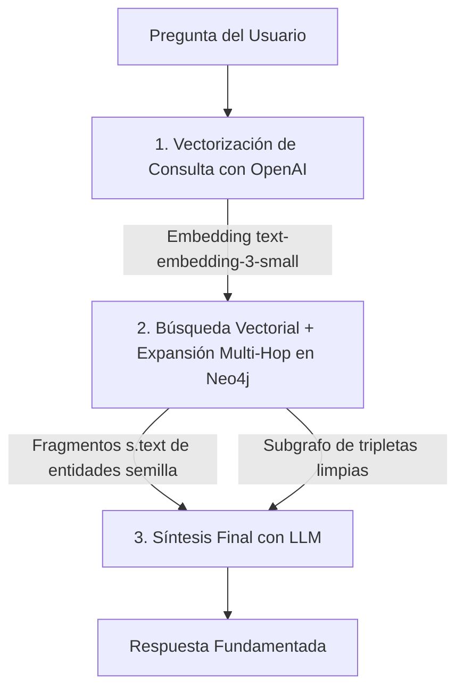

# Neo4j Vector-First GraphRAG Pipeline

Pipeline de consulta híbrida **GraphRAG Vector-First** implementado en Python con **LangChain**, **Neo4j** (almacenamiento unificado de vectores y grafos) y **OpenAI**.

A diferencia de las arquitecturas fragmentadas que dependen de bases de datos vectoriales externas, este sistema opera sobre una **única instancia unificada de Neo4j**: vectoriza la consulta del usuario, localiza semánticamente las entidades semilla mediante un índice vectorial (`entity_embeddings`), expande sus subgrafos contextuales multi-hop en un **solo *round-trip* de consulta Cypher**, y sintetiza una respuesta fundamentada combinando fragmentos textuales y relaciones estructurales.

---

## Arquitectura del Pipeline

El flujo de ejecución en `PipelineVectorFirst` (`consulta_vector_first.py`) consta de tres etapas principales:



1. **Vectorización Semántica de la Consulta (`OpenAIEmbeddings`):**
   * Convierte la pregunta del usuario en un vector denso utilizando el modelo `text-embedding-3-small` de OpenAI.
2. **Búsqueda Vectorial y Expansión de Subgrafo en Un Solo Round-Trip (`_obtener_contexto_vector_y_grafo`):**
   * Ejecuta una única consulta Cypher sobre nodos `:Entidad` utilizando la cláusula `SEARCH s IN (VECTOR INDEX entity_embeddings FOR $query_vector LIMIT $top_k)` para recuperar los `top_k` nodos semilla más relevantes junto con su `score` de similitud y su propiedad `text`.
   * Expande el vecindario de cada nodo semilla mediante `OPTIONAL MATCH path = (s)-[*1..{max_hops}]->(o:Entidad)` para extraer las relaciones salientes, etiquetas y propiedades relevantes.
   * Filtra metadatos internos de Neo4j (`id`, `nombre`, `vector`, `text`) para entregar tripletas estructurales limpias al modelo de lenguaje.
3. **Síntesis Fundamentada (`responder_pregunta`):**
   * Construye un contexto estructurado con los fragmentos de texto de las entidades semilla y las relaciones del subgrafo extraído.
   * Invoca a `gpt-4o-mini` (`temperature=0`) mediante `ChatPromptTemplate` con instrucciones estrictas para responder exclusivamente con base en la evidencia recuperada, evitando alucinaciones.

---

## Estructura del Proyecto

```text
neo4j-vector-first-graphrag-pipeline/
├── consulta_vector_first.py    # Clase principal PipelineVectorFirst y lógica Cypher unificada
├── main.py                     # Script de entrada con consulta de ejemplo
├── environment.yml             # Definición del entorno Conda y dependencias
├── .env                        # Variables de entorno (no versionado)
└── README.md                   # Documentación del proyecto
```

---

## Requisitos Previos

* **Python 3.13+** (o gestión mediante **Conda** / **Miniconda**).
* Una instancia activa de **Neo4j** (local o AuraDB con soporte de índices vectoriales y sintaxis `SEARCH`) con:
  * Nodos etiquetados como `:Entidad` que contengan las propiedades `id`, `nombre`, `text` y el embedding correspondiente.
  * Un índice vectorial creado bajo el nombre `entity_embeddings` sobre los nodos `:Entidad`.
* Una clave de API válida de **OpenAI**.

---

## Instalación

1. **Clonar el repositorio:**
   ```bash
   git clone https://github.com/DiegoAlejandroLozano/neo4j-vector-first-graphrag-pipeline.git
   cd neo4j-vector-first-graphrag-pipeline
   ```

2. **Crear y activar el entorno Conda:**
   ```bash
   conda env create -f environment.yml
   conda activate conda-graphrag-curso
   ```

---

## Configuración

Crea un archivo `.env` en la raíz del proyecto con tus credenciales de acceso:

```env
# OpenAI
OPENAI_API_KEY=sk-...

# Neo4j
NEO4J_URI=bolt://localhost:7687
NEO4J_USER=neo4j
NEO4J_PASSWORD=tu_password
```

---

## Uso

Ejecuta el script principal `main.py` para probar el pipeline con una consulta de ejemplo:

```bash
python main.py
```

### Ejemplo de integración en código

```python
from dotenv import dotenv_values
from consulta_vector_first import PipelineVectorFirst

config = dotenv_values(dotenv_path=".env")
pipeline = PipelineVectorFirst(
    openai_api_key = config.get("OPENAI_API_KEY"),
    neo4j_uri      = config.get("NEO4J_URI"),
    neo4j_user     = config.get("NEO4J_USER"),
    neo4j_pass     = config.get("NEO4J_PASSWORD")
)

try:
    pregunta = "¿Quién creó las herramientas en las que se inspiró FastAPI y qué dependencias o estándares utiliza?"
    respuesta = pipeline.responder_pregunta(
        consulta_usuario = pregunta,
        top_k            = 3,
        max_hops         = 1
    )
    print(respuesta)
finally:
    pipeline.close()
```

### Salida esperada en consola

```text
=== CONSULTA VECTOR-FIRTS ===
Pregunta: '¿Quién creó las herramientas en las que se inspiró FastAPI y qué dependencias o estándares utiliza?'


[PASO 1] Entidades semánticas encontradas en Neo4j (Vector Search):
 - ID: ent_01 | Nombre: 'FastAPI' (Score: 0.9142)
 - ID: ent_02 | Nombre: 'Starlette' (Score: 0.8510)
 - ID: ent_03 | Nombre: 'Pydantic' (Score: 0.8437)

[PASO 2] Subgrafo contextual extraído de Neo4j (4 relaciones)
 01. (FastAPI:Entidad) --[INSPIRADO_EN]--> (Starlette:Entidad)
 02. (FastAPI:Entidad) --[USA_ESTANDAR]--> (OpenAPI:Entidad)
 ...

=== PASO 3: RESPUESTA FINAL DEL LLM ===
...
```

---

## Tecnologías Utilizadas

* **[Neo4j Python Driver](https://neo4j.com/docs/python-manual/current/)** (`neo4j`) — Almacenamiento unificado de grafo y vectores, búsqueda semántica por índice (`entity_embeddings`) y expansión de subgrafos en Cypher.
* **[LangChain](https://www.langchain.com/)** (`langchain-core`, `langchain-openai`) — Orquestación de embeddings, plantillas de prompts y ejecución de cadenas LLM.
* **[OpenAI](https://platform.openai.com/)** (`text-embedding-3-small`, `gpt-4o-mini`) — Generación de embeddings semánticos y síntesis de respuestas fundamentadas.
* **[Python-dotenv](https://pypi.org/project/python-dotenv/)** — Gestión segura de credenciales y variables de entorno.